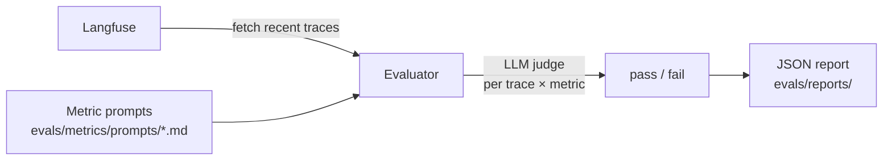
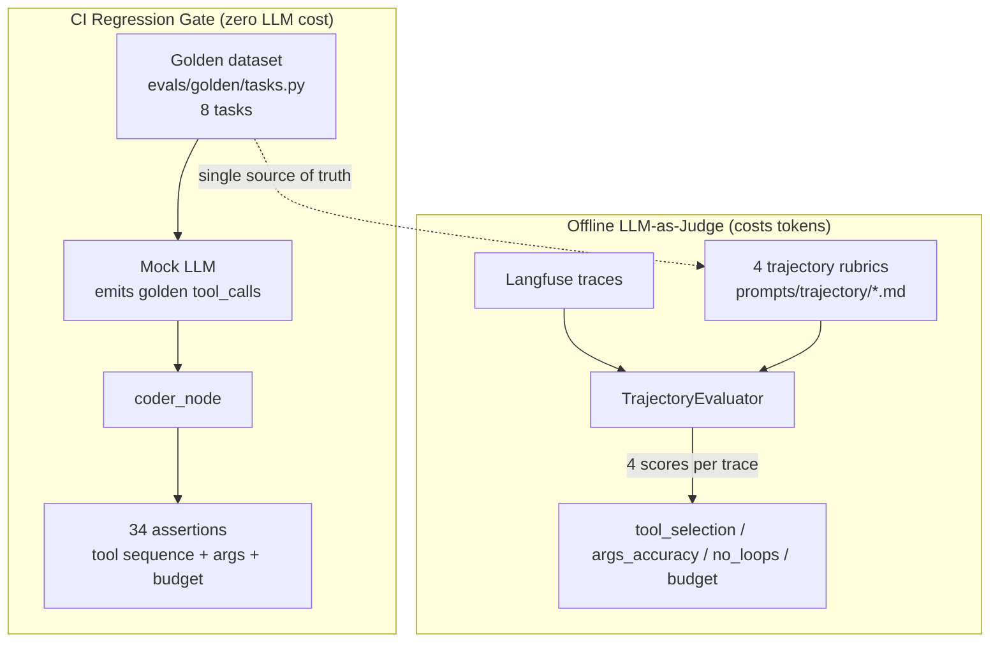

# Evaluation

The template includes a metric-based evaluation framework that fetches traces from Langfuse, scores them with LLM judges, and generates JSON reports.

## Running evaluations

```bash
make eval                        # interactive mode — prompts for settings
make eval-quick                  # runs with defaults, no prompts
make eval-no-report              # runs but skips report generation
make eval ENV=production         # run against production traces
```

## How it works



1. **Fetch traces** — pulls recent LLM traces from Langfuse (configured via `LANGFUSE_*` env vars)
2. **Score** — for each trace × metric combination, an LLM judge evaluates the output and returns pass/fail
3. **Report** — a JSON report with aggregated stats and per-trace results is saved to `evals/reports/`

## Built-in metrics

| Metric | What it checks |
| --- | --- |
| `helpfulness` | Did the response actually help the user? |
| `conciseness` | Was the response appropriately concise? |
| `hallucination` | Did the response contain made-up facts? |
| `relevancy` | Was the response on-topic? |
| `toxicity` | Did the response contain harmful content? |

## Adding a custom metric

1. Create a markdown file in `evals/metrics/prompts/`:

```markdown
# My Metric

Evaluate whether the assistant response...

## Scoring

Return "pass" if... Return "fail" if...
```

2. The evaluator auto-discovers and applies all `.md` files in that directory.

## Report format

Reports are saved to `evals/reports/evaluation_report_YYYYMMDD_HHMMSS.json`:

```json
{
  "summary": {
    "total_traces": 50,
    "success_rate": 0.92,
    "duration_seconds": 34.2
  },
  "metrics": {
    "helpfulness": {"pass": 48, "fail": 2, "rate": 0.96},
    "hallucination": {"pass": 45, "fail": 5, "rate": 0.90}
  },
  "traces": [...]
}
```

## Eval LLM configuration

The evaluator uses a separate LLM config so you can use a different (cheaper) model for judging:

```bash
EVALUATION_LLM=gpt-5
EVALUATION_API_KEY=...   # defaults to OPENAI_API_KEY if not set
```


## Trajectory-Level Evaluation

In addition to answer-level metrics, the framework supports trajectory-level
evaluation: assessing not just the final answer but the agent's tool selection,
parameter accuracy, redundant loops, and budget adherence.

### Architecture



### Two-layer evaluation

| Layer | Trigger | Cost | What it evaluates | How |
| --- | --- | --- | --- | --- |
| **Regression gate** | CI every push | Zero LLM | Tool set match, step <= budget, no loops, token <= budget, tool name valid | Mock LLM runs coder_node, asserts on 8 golden tasks |
| **LLM-as-Judge** | Manual `make eval-trajectory` | LLM tokens | Tool selection quality, args accuracy, loop semantics, budget adherence (0-1 score) | TrajectoryEvaluator fetches real Langfuse traces x 4 rubrics |

Both layers share the same golden dataset (`evals/golden/tasks.py`) and the same
trajectory rubrics (`evals/metrics/prompts/trajectory/*.md`).

### Trajectory rubrics

| Rubric | What it checks |
| --- | --- |
| `tool_selection` | Did the agent choose the right tools? (wrong tool, missing tool, unnecessary tool) |
| `tool_args_accuracy` | Were the parameters correct? (path, limit, no empty args) |
| `no_redundant_loops` | Any meaningless loops? (consecutive identical tool_calls, repeated reads) |
| `budget_adherence` | Within step/token budget? (steps <= max_steps, tokens <= max_tokens) |

### Running trajectory evaluation

```bash
make test-regression     # CI gate -- 34 assertions, zero LLM cost
make eval-trajectory     # offline LLM-as-Judge -- costs LLM tokens
```

### Golden dataset

The golden dataset (`evals/golden/tasks.py`) is the single source of truth,
consumed by both the regression tests (direct Python import) and the MCP server
(`seed_db.py` imports it to populate the `eval_golden` SQLite table).

| Task type | Expected tools | Max steps | Max tokens |
| --- | --- | --- | --- |
| landing_page | write_file, edit_file | 6 | 4000 |
| script | write_file, run_tests | 4 | 3000 |
| bug_fix | read_file, edit_file, run_tests | 6 | 5000 |
| refactor | read_file, edit_file, run_tests | 6 | 5000 |
| test_addition | read_file, write_file, run_tests | 5 | 4000 |
| config_update | read_file, edit_file | 4 | 2500 |
| api_endpoint | read_file, edit_file, run_tests | 6 | 5000 |
| mcp_lookup | mcp_query_tasks, read_file, edit_file | 5 | 4000 |

See `docs/eval-upgrade.md` for the full architecture decision record.
