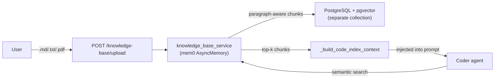

# Knowledge Base (RAG)

Upload documents (PDF, Markdown, API specs) that are indexed for semantic search and injected into the coder agent's context automatically. Complements the code index (which only indexes workspace code files) with user-supplied domain knowledge.

> Opt-in via `ENABLE_KNOWLEDGE_BASE=true` (default `false`). Zero regression when disabled — the router is not registered.

---

## Overview



**Design points:**

- **Per-user isolation** — every chunk is tagged with `user_id=str(user.id)`. Documents are shared across all of a user's tasks, but never visible to other users.
- **Separate collection** — uses `KNOWLEDGE_BASE_COLLECTION_NAME` (default `"knowledge_base"`), so it never pollutes the code index.
- **Non-blocking** — knowledge base search failures are logged and swallowed; code index results are still returned. RAG enhancement is best-effort.
- **PDF support is optional** — PyMuPDF is lazy-imported. If not installed, `.pdf` uploads return `extraction_failed` with a hint to install it.

---

## Setup

Add to `.env.development` (or your environment file):

```env
ENABLE_KNOWLEDGE_BASE=true
# Optional overrides (defaults shown):
KNOWLEDGE_BASE_COLLECTION_NAME=knowledge_base
KB_MAX_FILE_SIZE=10485760            # 10 MB
KB_ALLOWED_EXTENSIONS=md,txt,pdf,json,yaml,yml
KB_CHUNK_SIZE=500
KB_CHUNK_OVERLAP=50
```

For PDF support:

```bash
uv pip install pymupdf
```

Requires the same `OPENAI_API_KEY` and `pgvector` extension as long-term memory — see [docs/memory.md](memory.md).

---

## API endpoints

Base path: `/api/v1/knowledge-base`. All endpoints require a JWT `Authorization: Bearer <token>` header.

### Upload a document

```http
POST /api/v1/knowledge-base/upload
Content-Type: multipart/form-data
Authorization: Bearer <token>

file: <binary>
```

**Response (200):**

```json
{
  "doc_id": "550e8400-e29b-41d4-a716-446655440000",
  "filename": "api-spec.md",
  "chunk_count": 12,
  "status": "indexed"
}
```

**Errors:**

| Status | Cause |
| --- | --- |
| 404 | `ENABLE_KNOWLEDGE_BASE=false` |
| 413 | File exceeds `KB_MAX_FILE_SIZE` |
| 422 | Unsupported extension, empty file, or extraction failed (PDF without PyMuPDF) |

Rate limited: 10 uploads/minute.

### List documents

```http
GET /api/v1/knowledge-base/documents
Authorization: Bearer <token>
```

**Response:**

```json
[
  {"doc_id": "550e8400-...", "filename": "api-spec.md", "chunk_count": 12},
  {"doc_id": "660f9511-...", "filename": "design.pdf",  "chunk_count": 8}
]
```

Rate limited: 20 requests/minute.

### Delete a document

```http
DELETE /api/v1/knowledge-base/documents/{doc_id}
Authorization: Bearer <token>
```

**Response:**

```json
{
  "doc_id": "550e8400-e29b-41d4-a716-446655440000",
  "deleted_count": 12
}
```

Returns 404 if the document does not exist (or already deleted). Rate limited: 10 requests/minute.

---

## How the coder uses it

The coder node calls `_build_code_index_context`, which now retrieves both:

1. **Code index** — semantic search over workspace code files (always on when `CODE_INDEX_ENABLED=true`).
2. **Knowledge base** — semantic search over the user's uploaded documents (only when `ENABLE_KNOWLEDGE_BASE=true`).

The two result sets are merged and injected into the coder's system prompt. Knowledge base search failures are caught and logged — they never block code index results.

Example prompt fragment seen by the coder:

```
## Relevant knowledge base excerpts
[1] From api-spec.md:
    POST /api/v1/users — Create a new user. Requires `admin` role.
[2] From design.pdf:
    The authentication flow uses JWT with RS256 signatures...
```

---

## Chunking strategy

Knowledge base uses **paragraph-aware windowing** (vs. AST-based structural chunking for code):

1. Split text on double newlines (`\n\n`) into paragraphs.
2. Greedily accumulate paragraphs until `KB_CHUNK_SIZE` tokens are reached.
3. Overlap by `KB_CHUNK_OVERLAP` tokens to preserve cross-chunk context.

This preserves semantic boundaries better than fixed-size windowing for prose documents.

---

## Removal

The knowledge base is independently removable with no residual dependencies:

1. Set `ENABLE_KNOWLEDGE_BASE=false` (or remove the flag).
2. The router is not registered in `app/api/v1/api.py`.
3. The `knowledge_base_service` import in `app/core/langgraph/agents/context.py` is lazy-fault-tolerant — coder falls back to code-index-only context.

No database migration is required to disable. Existing chunks remain in the `knowledge_base` collection and can be dropped manually if desired.
