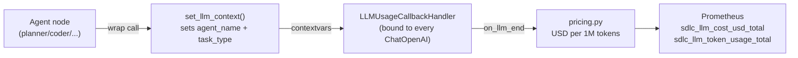

# LLM Cost Tracking

Per-agent LLM cost and token usage metrics for the SDLC orchestrator. Lets you answer questions like *"which agent is most expensive?"*, *"how much did this task cost?"*, and *"is cost dominated by prompts or completions?"*.

> Tracing is always on when `ENABLE_ADVANCED_MONITORING=true`. No additional setup required.

---

## Architecture



1. **`set_llm_context(agent_name, task_type)`** — a `contextvars.ContextVar` set by every SDLC agent node before its LLM call. Concurrent asyncio tasks each get an isolated copy.
2. **`LLMUsageCallbackHandler`** — bound to every `ChatOpenAI` instance in `app/services/llm/registry.py`. Fires on `on_llm_end` for both structured-output and `BaseMessage` paths.
3. **`pricing.py`** — multiplies token counts by per-model rates to produce USD cost.
4. **Prometheus** — three counters record the data (see [Metrics](#metrics) below).

This design covers both LLM call paths in the codebase:

- `llm_service.call(..., response_format=XxxOutput)` — Pydantic output, the caller never sees the `BaseMessage`, but the callback still fires.
- `get_llm_for(...).bind_tools(...).ainvoke(...)` — `BaseMessage` output, callback fires here too.

---

## Metrics

| Metric | Type | Labels | Description |
| --- | --- | --- | --- |
| `sdlc_llm_cost_usd_total` | Counter | `agent_name`, `model`, `task_type` | Total LLM cost in USD |
| `sdlc_llm_token_usage_total` | Counter | `agent_name`, `model`, `token_type` | Token usage split by `prompt` / `completion` |
| `sdlc_token_usage_total` | Counter | `agent_name`, `model` | Total token usage (legacy, kept for backwards compat) |

All three are defined in [`app/core/metrics.py`](../app/core/metrics.py) and incremented by [`app/services/llm/usage_tracker.py`](../app/services/llm/usage_tracker.py).

---

## Pricing table

Model prices are a module-level constant in [`app/services/llm/pricing.py`](../app/services/llm/pricing.py) — USD per 1M tokens, input and output separated.

```python
MODEL_PRICING_USD_PER_1M: Dict[str, Dict[str, float]] = {
    "qwen3.7-plus-2026-05-26":  {"input": 0.4, "output": 1.2},
    "qwen3.7-max-preview":      {"input": 2.4, "output": 9.6},
    "qwen3.7-max-2026-06-08":   {"input": 2.4, "output": 9.6},
    "kimi-k2.7-code":           {"input": 0.4, "output": 1.2},
    "local-qwen-0.5b":          {"input": 0.0, "output": 0.0},
}

# Conservative fallback so unknown models are never under-reported.
DEFAULT_PRICING = {"input": 1.0, "output": 3.0}
```

- Aligned with the models in `router.ROUTING_TABLE`.
- Unknown models fall back to `DEFAULT_PRICING` (intentionally higher than any known model, so costs are never silently under-reported).
- Update quarterly or whenever a model is added to `ROUTING_TABLE`.

---

## Per-agent attribution

Every SDLC agent node wraps its LLM calls with `set_llm_context()`:

| Agent | `agent_name` | `task_type` |
| --- | --- | --- |
| Planner | `planner` | `planning` |
| Supervisor | `supervisor` | `routing` |
| Coder | `coder` | `coding` |
| Tester | `tester` | `testing` |
| Reviewer | `reviewer` | `reviewing` |

Non-SDLC paths (chatbot, session naming) do not wrap their calls — they record under `agent_name="unknown"`, `task_type="general"`.

The shared `call_llm_structured` helper in [`app/core/langgraph/agents/context.py`](../app/core/langgraph/agents/context.py) handles this for planner/supervisor/reviewer. Coder and tester wrap their `bind_tools().ainvoke()` calls directly.

---

## PromQL examples

**Per-agent cost over the last hour:**

```promql
sum by (agent_name) (
  increase(sdlc_llm_cost_usd_total[1h])
)
```

**Daily cost trend, split by model:**

```promql
sum by (model) (
  increase(sdlc_llm_cost_usd_total[1d])
)
```

**Cost composition: prompt vs completion tokens:**

```promql
sum by (token_type) (
  increase(sdlc_llm_token_usage_total[1h])
)
```

**Estimated cost per workflow** (assumes one workflow per `thread_id`, ~5 min window):

```promql
sum by (agent_name) (
  increase(sdlc_llm_cost_usd_total[5m])
)
```

**Most expensive task types:**

```promql
topk(5,
  sum by (task_type) (
    increase(sdlc_llm_cost_usd_total[1h])
  )
)
```

---

## Verification

After running an SDLC task, scrape the metrics endpoint:

```bash
curl http://localhost:8000/metrics | grep sdlc_llm
```

Expected output (truncated):

```
sdlc_llm_cost_usd_total{agent_name="planner",model="qwen3.7-plus",task_type="planning"} 0.0024
sdlc_llm_token_usage_total{agent_name="planner",model="qwen3.7-plus",token_type="prompt"} 4500
sdlc_llm_token_usage_total{agent_name="planner",model="qwen3.7-plus",token_type="completion"} 1200
```

---

## Budget alerts (deferred)

Automatic budget enforcement (block + auto-downgrade model) was evaluated and **deferred** due to high risk:

- Runtime router mutation mid-task breaks in-flight calls.
- Mid-task model switch corrupts LangGraph checkpoint state.
- Concurrent workflow cost tracking requires extra persistence.

**Recommended approach:** use Prometheus AlertManager with rules like:

```yaml
- alert: HighLLMCostPerHour
  expr: sum(increase(sdlc_llm_cost_usd_total[1h])) > 10
  for: 5m
  annotations:
    summary: "LLM cost exceeded $10 in the last hour"
```

This delivers alerts without the runtime risks of automatic model downgrade.
