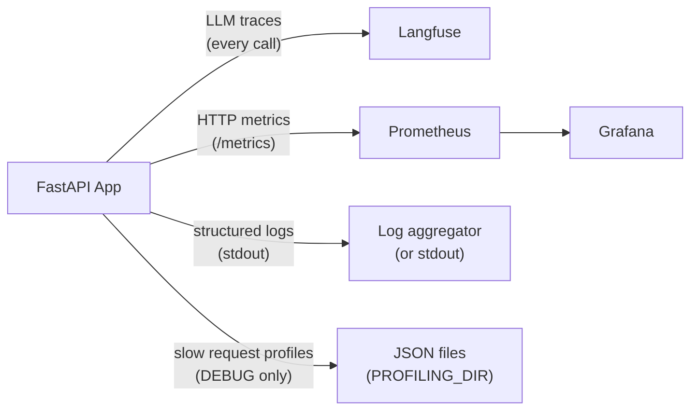

# Observability

## Overview



---

## Langfuse — LLM tracing

Every LLM call is traced via the LangChain `CallbackHandler`. Traces include:

- Input messages and output
- Token usage and cost
- Latency per call and per session
- Model name, temperature, and other parameters

**Setup:**

```bash
LANGFUSE_TRACING_ENABLED=true
LANGFUSE_PUBLIC_KEY=pk-...
LANGFUSE_SECRET_KEY=sk-...
LANGFUSE_HOST=https://cloud.langfuse.com   # or your self-hosted URL
```

**Disable for local dev:**

```bash
LANGFUSE_TRACING_ENABLED=false
```

Traces are also used as the data source for the [evaluation framework](evaluation.md).

---

## Structured logging

All logs use [structlog](https://www.structlog.org/) in a consistent format:

- **Development**: coloured console output
- **Production**: JSON (pipe to your log aggregator)

Every log line automatically carries `request_id`, `session_id`, and `user_id` when available — bound by `LoggingContextMiddleware`.

### Log format conventions

```python
# Good
logger.info("chat_request_received", session_id=session.id, message_count=5)

# Never
logger.info(f"chat request received for {session.id}")  # no f-strings
logger.error("something failed", error=str(e))          # use logger.exception for exceptions
```

Rules:

- Event names are `lowercase_with_underscores`
- Variables are keyword arguments, never interpolated into the event string
- Use `logger.exception()` (not `.error()`) when inside an `except` block — preserves the full traceback

### Log levels by environment

| Environment | Level |
| --- | --- |
| development | DEBUG |
| staging | INFO |
| production | WARNING |

---

## Prometheus metrics

Metrics are exposed at `GET /metrics` and scraped by Prometheus.

| Metric | Type | Description |
| --- | --- | --- |
| `http_requests_total` | Counter | Request count by method, endpoint, status |
| `http_request_duration_seconds` | Histogram | Request latency by method, endpoint |
| `llm_inference_duration_seconds` | Histogram | LLM call latency by model |
| `llm_stream_duration_seconds` | Histogram | Streaming call latency by model |
| `db_connections` | Gauge | Active database connections |

Grafana dashboards are pre-configured in `grafana/`. Start the full stack with `make stack-up ENV=development` to access them at [http://localhost:3000](http://localhost:3000) (admin/admin).

---

## Request profiling (debug only)

When `DEBUG=true`, `ProfilingMiddleware` profiles every request using [pyinstrument](https://github.com/joerick/pyinstrument). When a request exceeds `PROFILING_THRESHOLD_SECONDS`, a JSON report is saved to `PROFILING_DIR`.

Each report file is named `{request_id}.json` and contains:

```json
{
  "request_id": "...",
  "endpoint": "POST /api/v1/chatbot/chat",
  "wall_time_ms": 1842,
  "cpu_time_ms": 145,
  "io_wait_ms": 1697,
  "memory_peak_kb": 4820,
  "top_memory_allocators": [...],
  "call_tree": {...}
}
```

Set `PROFILING_THRESHOLD_SECONDS=0` to profile every request.

The `request_id` in the filename matches the `X-Request-ID` response header, so you can correlate profiles with specific log lines.

---

## Request ID propagation

Every request gets a unique `X-Request-ID` header via [`asgi-correlation-id`](https://github.com/snok/asgi-correlation-id). This ID is:

- Returned in the response headers
- Bound to every log line for that request
- Used as the filename for profile reports

Use the `X-Request-ID` from a response to grep logs, find profiles, and look up Langfuse traces for that exact request.

## vLLM — Local model service metrics

The vLLM serving container (`vllm/vllm-openai:v0.8.5`, port 8001) exposes a
Prometheus-format metrics endpoint at `http://vllm:8001/metrics` (visible
to the host as `http://localhost:8001/metrics`). The endpoint is part of
vLLM 0.8+ and requires no configuration.

### Snapshot script

`test_data/vllm_metrics.py` collects and prints key metrics. Three modes:

```bash
# One-shot snapshot (no LLM calls)
.venv/bin/python test_data/vllm_metrics.py

# Watch loop (Ctrl+C to stop, default 5s interval)
.venv/bin/python test_data/vllm_metrics.py --watch

# Stress test: send N requests with identical prefix, then snapshot.
# Use this to verify prefix cache behaviour.
.venv/bin/python test_data/vllm_metrics.py --stress 30
```

### Key metrics to monitor

| Metric | Source | What to look for |
|---|---|---|
| KV cache usage | `vllm:gpu_cache_usage_perc` | `> 90%` warns: consider raising `max-num-seqs` only after hardware upgrade |
| Preemptions | `vllm:num_preemptions_total` | `> 0` means KV cache evicted entries (frequent = memory pressure) |
| Prefix cache status | `vllm:cache_config_info{enable_prefix_caching="True"}` | Must be `True` for the optimisation to apply |
| Block size | `vllm:cache_config_info{block_size="16"}` | 16 is the vLLM default; increasing saves memory but reduces hit rate |
| TTFT | `vllm:time_to_first_token_seconds` | P50 should drop on repeated identical-prefix calls (cache warmup) |
| Prefill | `vllm:request_prefill_time_seconds` | Drops sharply on cache hit; the most direct cache-health signal |
| Decode | `vllm:request_decode_time_seconds` | Stable per-token; spikes indicate model load or VRAM pressure |
| E2E latency | `vllm:e2e_request_latency_seconds` | Sum of queue + prefill + decode; user-visible |
| Success count | `vllm:request_success_total` | Compare against total to derive success rate |

### vLLM 0.8.5 note: no hit/queries counters

vLLM 0.8.5 does **not** expose `vllm:prefix_cache_hits` or
`vllm:prefix_cache_queries` Prometheus counters — those are added in
0.9+. To verify prefix caching is actually working, watch how
`request_prefill_time_seconds` and `time_to_first_token_seconds` change
as you send repeated requests with the same `system` prompt:

```bash
# First call: cold prefill (high).
# Calls 2-30: warm prefill (drops by 2-5x as prefix is cached).
.venv/bin/python test_data/vllm_metrics.py --stress 30
```

The first few requests establish the baseline; subsequent identical-prefix
requests show a clear prefill-time drop. If prefill stays constant across
all 30, prefix caching is broken or the prompt is too small to be cached.

### Alert thresholds (recommended)

| Trigger | Action |
|---|---|
| KV cache > 90% for > 5 min | Investigate prompt length; consider lowering `max-model-len` |
| Preemptions > 0 sustained | Memory pressure; lower `max-num-seqs` or upgrade hardware |
| TTFT P99 > 3s | Check GPU utilisation, model warmup, network |
| `enable_prefix_caching="False"` | Service was started without the flag; restart with Phase A flags |

### GPU memory baseline

Quick one-liner to check VRAM (host side):

```bash
nvidia-smi --query-gpu=memory.used,memory.total,utilization.gpu --format=csv
```

Expected for Qwen2.5-0.5B-Instruct (FP16) + Phase A config:
~3650 MiB used / 4096 MiB total (≈ 89%). If significantly higher, vLLM
is allocating more than `gpu-memory-utilization=0.88` (CUDA/cuDNN overhead).

---

## vLLM OOM-risk preemption monitor (Phase B+)

The app runs a background coroutine (`app.core.vllm_health.VLLMHealthMonitor`)
that scrapes the vLLM Prometheus endpoint every 30 seconds and emits
structured log events when the signals most strongly correlated with
upcoming OOM cross configured thresholds. The monitor is enabled by
default and lives inside `app.main.lifespan` — it starts after
`agent.create_graph()` and is stopped before the rest of the shutdown
sequence.

### What it watches

| Metric | Type | Why it matters |
|---|---|---|
| `vllm:num_preemptions_total` | counter (delta) | Most direct OOM signal. Any non-zero increment means a request was evicted from the KV cache to make room for another. |
| `vllm:gpu_cache_usage_perc` | gauge (%) | Headroom indicator. > 0.85 leaves little room for a 1500-token request; > 0.95 means a long-context call will likely preempt something. |
| `vllm:request_success_total` | counter (delta) | Used only to detect vLLM restarts (counter wrap). |

### Configuration

All thresholds live in `.env.production` (or `.env.development`) and
default to safe values for the 4GB-VRAM single-user box:

```bash
VLLM_HEALTH_CHECK_ENABLED=true              # master switch
VLLM_METRICS_URL="http://vllm:8001/metrics" # compose-internal hostname
VLLM_HEALTH_CHECK_INTERVAL_SECONDS=30       # same cadence as docker healthcheck
VLLM_HEALTH_CHECK_TIMEOUT_SECONDS=5
VLLM_PREEMPTION_WARN_THRESHOLD=1            # any preemption triggers WARNING
VLLM_KV_CACHE_WARN_THRESHOLD=0.85
VLLM_KV_CACHE_CRITICAL_THRESHOLD=0.95
```

Raise `VLLM_PREEMPTION_WARN_THRESHOLD` to suppress noise during stress
tests. The `vllm_health_monitor` poller is independent of the chat
request path, so disabling it never affects user-visible behavior — the
app keeps falling back to cloud models on any LLM error.

### Log events emitted

All events are structlog JSON (production) or coloured console
(development). The `event` field is the key to grep on:

| Event | Level | When | Key fields |
|---|---|---|---|
| `vllm_health_monitor_started` | INFO | On app startup | `url`, `interval_seconds`, thresholds |
| `vllm_health_baseline` | INFO | First sample after startup | `preemptions`, `kv_cache_pct`, `requests_served` |
| `vllm_health_sample` | DEBUG | Every successful sample | `preempt_delta`, `kv_cache_pct` |
| `vllm_metrics_unreachable` | WARNING | HTTPError (timeout, conn refused) | `url`, `error` |
| `vllm_metrics_non_200` | WARNING | Non-200 from /metrics | `status_code`, `body_preview` |
| `vllm_restart_detected` | INFO | Counter wrap detected | before/after counts |
| `vllm_preemption_detected` | WARNING (or ERROR if sustained ≥ 3 intervals) | `preempt_delta ≥ VLLM_PREEMPTION_WARN_THRESHOLD` | `delta`, `total`, `kv_cache_pct`, `sustained_intervals`, `severity` |
| `vllm_kv_cache_high` | WARNING | `kv_cache_pct ≥ VLLM_KV_CACHE_WARN_THRESHOLD` | `kv_cache_pct`, `sustained_intervals` |
| `vllm_kv_cache_critical` | ERROR | `kv_cache_pct ≥ VLLM_KV_CACHE_CRITICAL_THRESHOLD` | `kv_cache_pct`, `sustained_intervals` |
| `vllm_health_sample_failed` | ERROR | Unexpected exception in the poller | `error`, `error_type` |
| `vllm_health_monitor_stopped` | INFO | On app shutdown | — |

### Grep recipes

```bash
# Any preemption in the last 24h
journalctl -u sdlc-orchestrator --since "24h ago" | \
  jq 'select(.event == "vllm_preemption_detected")'

# Count of preemption events by hour
jq -r 'select(.event == "vllm_preemption_detected") | .timestamp[0:13]' \
  /var/log/sdlc/production-*.jsonl | sort | uniq -c

# Sustained KV cache pressure
jq 'select(.event | startswith("vllm_kv_cache")) | {ts: .timestamp, event, kv: .kv_cache_pct}' \
  /var/log/sdlc/production-2026-07-20.jsonl

# vLLM outages
jq 'select(.event == "vllm_metrics_unreachable")' \
  /var/log/sdlc/production-2026-07-20.jsonl
```

### Failure-mode policy

The monitor is **non-blocking** and **optional**:

- HTTP errors reaching `VLLM_METRICS_URL` are logged at WARNING, never
  raised. The app continues to serve via the cloud fallback chain.
- The monitor task is registered with `task_manager` and is cancelled
  during shutdown alongside other background tasks. A
  `vllm_health_monitor_stopped` line is emitted as the last act of
  shutdown.
- Sampling is wrapped in a try/except so a single bad sample (e.g.
  malformed response body) cannot kill the poller permanently — the
  next interval will retry.

### Cross-references

- Implementation: [app/core/vllm_health.py](../app/core/vllm_health.py)
- Settings: `app/core/config.py::Settings.VLLM_*`
- Lifecycle wiring: `app/main.py::lifespan`
- vLLM optimization context: [vllm-optimization.md](vllm-optimization.md)
