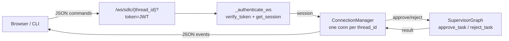

# WebSocket Real-Time SDLC

Bidirectional WebSocket endpoint for SDLC interaction: client-side approve/reject commands and server-side status responses. Supplements the primary SSE streaming interface.

> Opt-in via `ENABLE_WEBSOCKET=true` (default `false`). The endpoint is not registered when disabled. SSE (`/sdlc/stream`) remains the primary interface.

---

## Overview



**Design points:**

- **Authentication via query param** — browsers cannot set Authorization headers on WebSocket handshakes, so the JWT is passed as `?token=<JWT>`. The token's `sub` claim must be a valid `session_id` (same as HTTP session validation).
- **One connection per thread_id** — concurrent connections to the same thread are rejected with code 4002. Prevents concurrent state mutations on the same graph.
- **Server-side push is deferred** — the current implementation only returns command results. Proactive event push (graph state changes, agent events) is planned but not yet implemented.

---

## Setup

Add to `.env.development` (or your environment file):

```env
ENABLE_WEBSOCKET=true
```

That's it. The router is registered in `app/api/v1/api.py` when the flag is true.

---

## Endpoint

```
ws://host:8000/api/v1/ws/sdlc/{thread_id}?token=<JWT>
```

- `thread_id` — the SDLC thread to interact with (path parameter).
- `token` — JWT token issued by `POST /auth/session` (query parameter).

---

## Authentication

The WebSocket handler reuses the same validation logic as HTTP endpoints:

1. `verify_token(token)` — extracts `session_id` from the JWT `sub` claim.
2. `get_session(session_id)` — confirms the session exists in the database.

This matches the HTTP `get_current_session` dependency exactly. Tokens issued for HTTP endpoints work for WebSocket, and vice versa.

**Close codes:**

| Code | Reason |
| --- | --- |
| 4001 | Authentication failed (invalid token or unknown session) |
| 4002 | Thread already has an active connection |
| 4003 | `ENABLE_WEBSOCKET=false` |

---

## Protocol

### Client → Server

Send JSON messages of the form:

```json
{"command": "approve|reject|status", "payload": {...}}
```

| Command | Payload | Description |
| --- | --- | --- |
| `approve` | *(empty)* | Resume an interrupted graph with approval |
| `reject` | `{"reason": "..."}` | Resume an interrupted graph with rejection |
| `status` | *(empty)* | Query current connection status (non-mutating) |

`cancel` and `modify` are **not supported**:

- `cancel` — LangGraph `astream_events` cannot be cancelled externally.
- `modify` — mid-execution state modification risks consistency issues.

### Server → Client

**On connect:**

```json
{
  "type": "connected",
  "thread_id": "abc-123",
  "message": "WebSocket connected. Send commands: approve, reject, status"
}
```

**Command result (`approve`):**

```json
{
  "type": "command_result",
  "command": "approve",
  "status": "coding",
  "is_complete": false,
  "human_approval_needed": false
}
```

**Command result (`reject`):**

```json
{
  "type": "command_result",
  "command": "reject",
  "status": "completed",
  "is_complete": true
}
```

**Status query:**

```json
{"type": "status", "thread_id": "abc-123", "connected": true}
```

**Error:**

```json
{"type": "error", "message": "Unknown command: foo. Supported: approve, reject, status"}
```

---

## Example session

JavaScript browser example:

```javascript
const token = "<JWT from POST /auth/session>";
const threadId = "abc-123";
const ws = new WebSocket(
  `ws://localhost:8000/api/v1/ws/sdlc/${threadId}?token=${token}`
);

ws.onmessage = (event) => {
  const msg = JSON.parse(event.data);
  console.log("Server:", msg);
};

ws.onopen = () => {
  // Wait for the graph to reach an interrupt, then approve:
  ws.send(JSON.stringify({command: "approve", payload: {}}));
};
```

Python CLI example (using `websockets`):

```python
import asyncio
import json
import websockets

async def main():
    token = "<JWT>"
    thread_id = "abc-123"
    url = f"ws://localhost:8000/api/v1/ws/sdlc/{thread_id}?token={token}"
    async with websockets.connect(url) as ws:
        # Read the initial "connected" event
        print(await ws.recv())

        # Approve the current interrupt
        await ws.send(json.dumps({"command": "approve", "payload": {}}))
        print(await ws.recv())

asyncio.run(main())
```

---

## Relationship to SSE

| Aspect | SSE (`/sdlc/stream`) | WebSocket (`/ws/sdlc/{thread_id}`) |
| --- | --- | --- |
| Status | Primary | Optional supplement |
| Direction | Server → Client (one-way) | Bidirectional |
| Use case | Streaming agent events, token-by-token | Interactive approve/reject without polling |
| Auth | HTTP header | Query param |
| Feature flag | Always on | `ENABLE_WEBSOCKET=true` |

SSE remains the primary interface for streaming agent output. WebSocket is an optional enhancement for clients that need bidirectional interaction (e.g. a dashboard that approves/rejects in real time without HTTP polling).

---

## Removal

The WebSocket module is independently removable with no residual dependencies:

1. Set `ENABLE_WEBSOCKET=false` (or remove the flag).
2. The router is not registered in `app/api/v1/api.py`.
3. No other module imports from `app/api/v1/ws.py`.

No database migration is required to disable.
